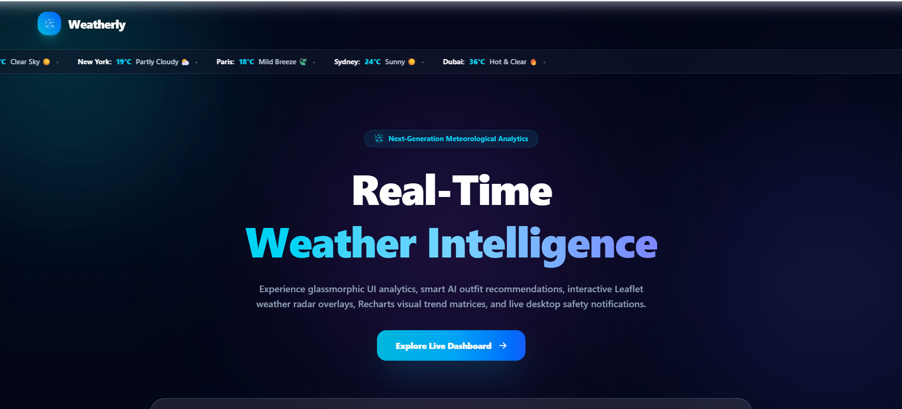
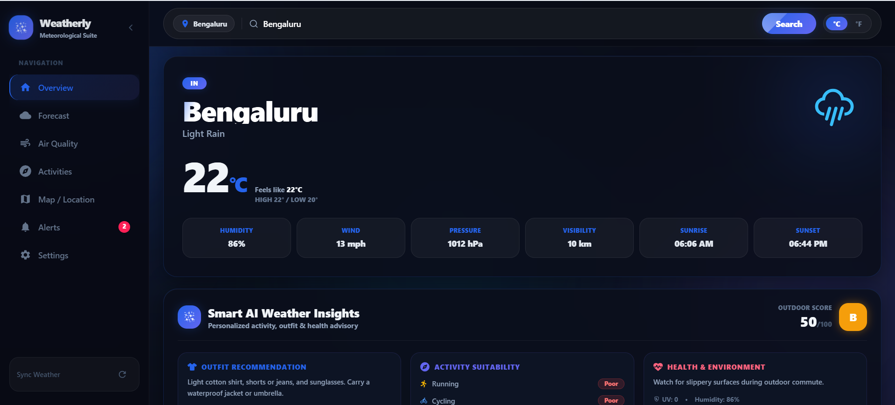

# Demo Link
https://weatherlyboard.netlify.app/

# 🌤️ Weatherly - Advanced Weather Dashboard

A modern, responsive weather dashboard built with **React**, **Vite**, and **Tailwind CSS** that provides real-time weather data and comprehensive forecasts using the **OpenWeather API**.

## 🖼️ Application Screenshots

| 🚀 Landing Page | 📊 Desktop Dashboard | 📱 Mobile Dashboard |
| :---: | :---: | :---: |
|  |  |  |

---

### 📍 Weather Features
- **Real-time Current Weather** - Live temperature, conditions, humidity, and pressure
- **Multi-Location Support** - Save and switch between multiple cities
- **5-Day Forecast** - Daily weather predictions with high/low temperatures
- **Hourly Forecast** - Next 48 hours with 3-hour intervals
- **Weekly Extended Forecast** - 14-day outlook
- **Weather Alerts** - National alerts when available from API


## 🛠️ Tech Stack

| Technology | Purpose |
|-----------|---------|
| **React 19.2** | UI framework |
| **Vite 8.0** | Build tool & dev server |
| **Tailwind CSS 4.3** | Styling |
| **Axios 1.17** | HTTP requests |
| **React Icons 5.6** | Icon library |
| **Framer Motion 12.40** | Animations |
| **OpenWeather API 2.5** | Weather data |

---

## 🚀 Setup & Installation

### Prerequisites
- Node.js 24+ 
- npm or yarn package manager

### Installation Steps


1. **Install dependencies**
   ```bash
   npm install
   ```
2. **Start development server**
   ```bash
   npm run dev
   ```
   The app will be available at `http://localhost:5174/`

3. **Build for production**
   ```bash
   npm run build
   ```
